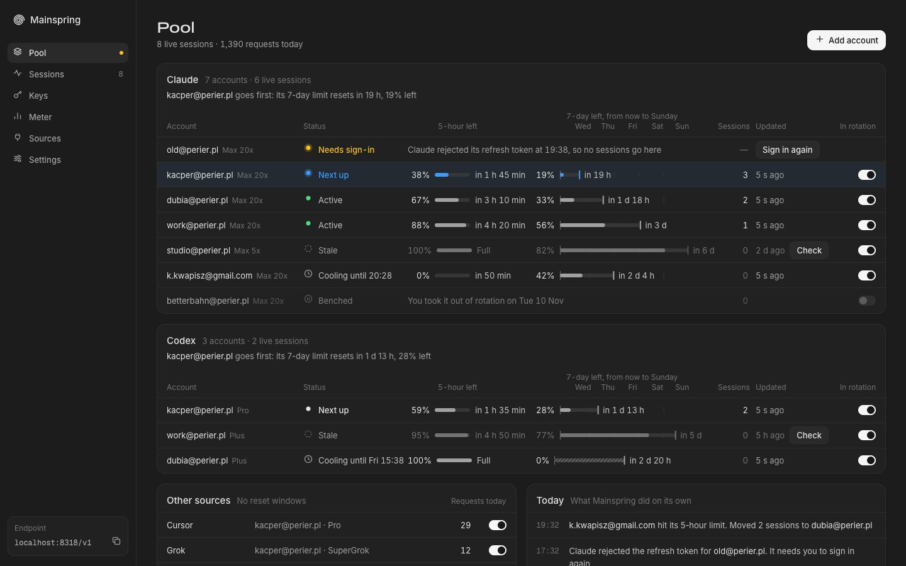

<p align="center">
  
</p>

<h1 align="center">Mainspring</h1>

<p align="center">One endpoint for all your AI subscriptions.</p>

Mainspring runs on one always-on computer at home and pools the AI subscriptions you already pay for: Claude, Codex (ChatGPT), Grok, Cursor, OpenCode Console, and any OpenAI-compatible API. Every other machine points Claude Code, Codex, Cursor, OpenCode or anything that speaks the OpenAI or Anthropic API at that one address.

- **Logins stay fresh.** Mainspring refreshes tokens before they expire and tells you when a provider rejects one.
- **Sessions stay put.** Every request of a coding session goes to the same account, so its prompt cache stays warm.
- **Limits are read, not guessed.** Each response carries the account's quota windows. An account that runs out rests until its window resets, and its sessions move to another account.
- **Soonest reset first.** New sessions go to the account whose limit resets soonest while it still has reserve, so quota you've paid for doesn't expire unused.
- **One place to look.** The panel shows each account's windows and when they reset, live sessions and their cache hit rate, a usage meter at API list price, and the keys you hand out.

> [!WARNING]
> Using a subscription through a proxy may break a provider's terms, and providers can suspend accounts. Run Mainspring at home rather than on a cloud server, use only your own accounts, and don't serve other people's traffic with them.

## Install

### Umbrel

1. Open **App Store → ⋯ → Community App Stores** and add `https://github.com/kacperkwapisz/mainspring-umbrel`.
2. Install **Mainspring** from that store and open it from the dashboard.

Umbrel's login protects the panel. The API answers at `http://umbrel.local:8317/v1` to the keys you create in the panel.

### Docker

```bash
docker run -d --name mainspring -p 8317:8317 -v mainspring-data:/data \
  ghcr.io/kacperkwapisz/mainspring:latest
docker logs mainspring   # prints the one-time setup code
```

### Binary

Download a release for Linux or macOS from [Releases](https://github.com/kacperkwapisz/mainspring/releases), then:

```bash
chmod +x mainspring && ./mainspring
```

Data lives in `~/.mainspring` (`mainspring.sqlite` and the `jwt_secret` that encrypts your credentials). The bare binary listens on `127.0.0.1:8317`; set `HOST=0.0.0.0` to reach it from other machines.

## First run

1. **Sign in to the panel.** Outside Umbrel the panel uses security keys and passkeys, with no password. Open it over HTTPS or on `localhost`, enter the setup code Mainspring printed when it started, and add a key. Add a second one as a backup.
2. **Add accounts.** Choose **Add account**. Claude and Codex open their sign-in page in a new tab. When Mainspring runs on another machine, that tab ends on a page that can't load; copy its whole address into the panel. Grok uses a device code, Cursor a sign-in or an API key, OpenCode Console a service account key, and OpenAI-compatible APIs a base URL.
3. **Create a key per machine** under **Keys**. The panel shows the exact config for Claude Code, Codex and other tools when you create one.

Security keys are registered without a passkey, so they don't take up one of your YubiKey's passkey slots. Lost every key? Run `mainspring auth reset` on the host for a fresh setup code.

## Point your tools at it

Claude Code, in `~/.claude/settings.json`:

```json
{
  "env": {
    "ANTHROPIC_BASE_URL": "https://hub.example.ts.net:8317",
    "ANTHROPIC_AUTH_TOKEN": "sk-ms-…"
  }
}
```

Codex, in `~/.codex/config.toml`:

```toml
model_provider = "mainspring"

[model_providers.mainspring]
name = "Mainspring"
base_url = "https://hub.example.ts.net:8317/v1"
wire_api = "responses"
requires_openai_auth = false
supports_websockets = true
experimental_bearer_token = "sk-ms-…"
```

Anything else takes `https://hub.example.ts.net:8317/v1` as an OpenAI base URL and the `sk-ms-` key as its API key. `GET /v1/models` lists every model ID your accounts can serve.

To reach the hub from other machines, [Tailscale](https://tailscale.com) works well: `tailscale serve --bg --https=8317 http://127.0.0.1:8317` gives it an HTTPS address only your tailnet can reach, which security keys also need.

## How routing works

For each request Mainspring picks the provider from the model ID, then an account:

1. The account the session already uses, while the session has been active within the last hour (configurable).
2. Otherwise the account whose longest quota window resets soonest and still has reserve.
3. Accounts with no quota data yet, oldest first.

Accounts that are out of rotation, waiting for a sign-in, or resting after a limit are skipped. A 429 rests the account until the window that ran out resets, using the reset time the provider sends. If every account of a provider is resting, clients get a 429 with `Retry-After` set to when the first one is back. Plain model IDs like `claude-opus-5` can fall back to Cursor on retryable errors, and `cursor/…` IDs always use Cursor.

Codex can talk to Mainspring over WebSockets (`supports_websockets = true`). Usage dashboards such as T3 Code can read pooled limits through a read-only management key (**Settings → Usage hub**).

## Configuration

| Variable | Default | What it does |
|---|---|---|
| `HOST` | `127.0.0.1` (Docker: `0.0.0.0`) | Address to listen on |
| `PORT` | `8317` | Port to listen on |
| `MAINSPRING_HOME` | `~/.mainspring` | Data directory for the binary |
| `DATABASE_PATH` | `$MAINSPRING_HOME/mainspring.sqlite` (Docker: `/data/mainspring.sqlite`) | SQLite database |
| `JWT_SECRET` | generated next to the database | Encrypts stored credentials and signs panel sessions |
| `MAINSPRING_AUTH` | `webauthn` | `webauthn`: sign in with a security key or passkey. `proxy`: a reverse proxy in front (like Umbrel) signs you in |
| `MAINSPRING_TRUST_PROXY` | unset | `1` trusts `X-Forwarded-Host` and `X-Forwarded-Proto` |
| `PUBLIC_URL` | unset | The HTTPS address the panel suggests when opened over plain HTTP |
| `LOG_LEVEL` | `info` | `debug` also logs successful requests |

## API

- `POST /v1/chat/completions`, `POST /v1/responses` (also over WebSocket), `POST /v1/responses/compact`
- `POST /v1/messages`, `POST /v1/messages/count_tokens`
- `GET /v1/models`, `GET /health`

Authenticate with `Authorization: Bearer sk-ms-…` or `x-api-key: sk-ms-…`.

## Development

```bash
make test
go run ./cmd/mainspring demo     # the panel with made-up accounts, at http://127.0.0.1:8318
go run ./cmd/mainspring          # the real thing
```

`mainspring demo -sign-in` tries the security-key screens. The panel is plain HTML, Alpine.js and CSS in `internal/panel/web`, with no build step.

## Credits

Mainspring started from ideas in [CLIProxyAPI](https://github.com/router-for-me/CLIProxyAPI). See [NOTICE.md](NOTICE.md) for third-party code. MIT licensed.
